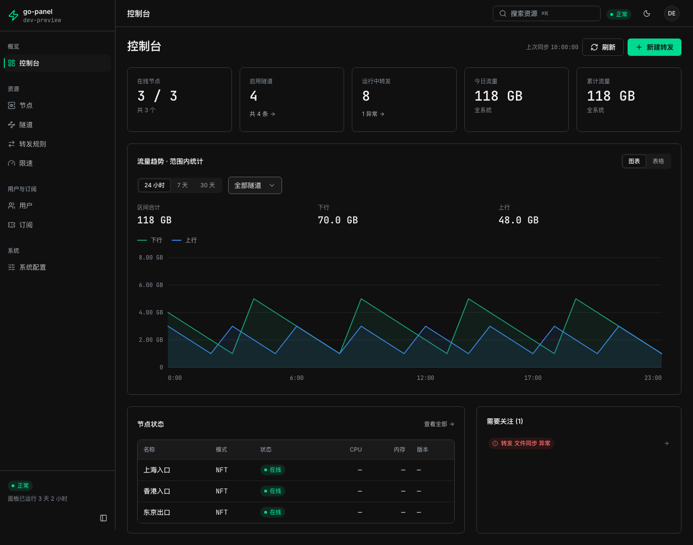
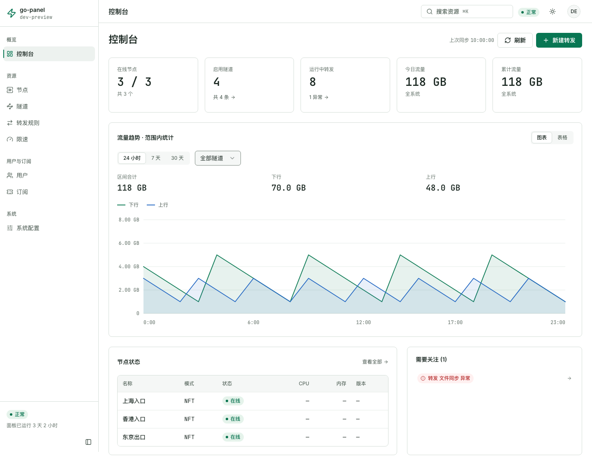
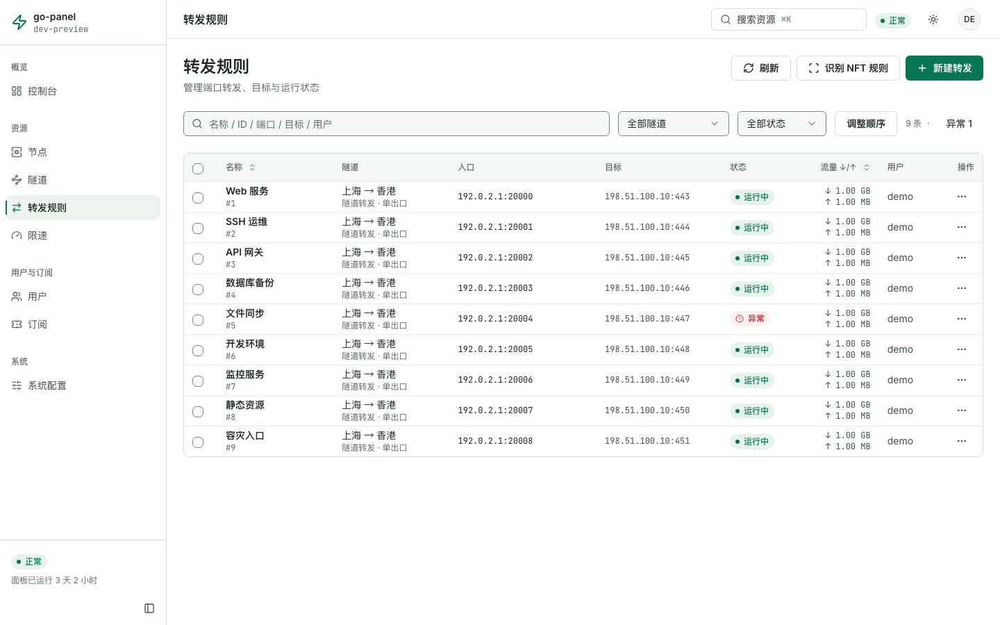
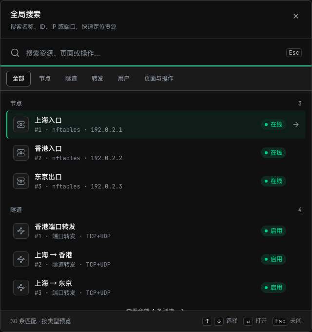
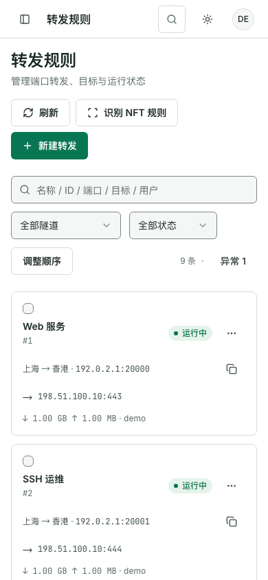

# go-panel

**自托管的网络转发与节点管理面板。** 在一个界面中管理节点、隧道、转发规则、用户配额和客户端订阅。

[](https://github.com/nXiaoK/go-panel/actions/workflows/ci.yml)
[](https://github.com/nXiaoK/go-panel/releases)
[](https://github.com/nXiaoK/go-panel/pkgs/container/go-panel)
[](LICENSE)

Go 后端内嵌 React 界面，使用 SQLite 保存数据。通过一个 Docker 容器即可部署面板，无需另建数据库或单独部署前端；支持 `linux/amd64` 与 `linux/arm64`。

[快速开始](#快速开始) · [界面预览](#界面预览) · [部署与运维](OPERATIONS.md) · [版本下载](https://github.com/nXiaoK/go-panel/releases) · [问题反馈](https://github.com/nXiaoK/go-panel/issues)



> 截图来自项目实际界面，使用演示数据与文档保留 IP，不包含真实服务器或用户信息。项目仍在迭代，升级前请备份数据库并阅读对应 Release Notes。

## 可以用它做什么

| 能力 | 说明 |
| --- | --- |
| 节点管理 | 接入 go-gost 或 nftables 节点，查看在线状态与运行指标，生成安装命令并升级节点组件 |
| 隧道与转发 | 管理 TCP/UDP 转发、入口与出口、多个目标及管理员配置的出口切换；支持规则诊断和批量操作 |
| 状态同步 | 节点离线或响应丢失时保留期望配置，重连后自动对账，使节点规则与面板配置保持一致 |
| 用户与配额 | 区分管理员和普通用户，管理隧道授权、流量配额、到期时间、转发数量与限速策略 |
| 客户端订阅 | 管理协议节点和订阅链接，提供 Surge、Clash、v2rayN、sing-box 格式；可用协议以各客户端支持范围为准 |
| 备份与更新 | 下载、恢复 SQLite 一致性备份，配置 Cloudflare R2 定时备份，检查版本并可选启用容器一键更新 |

面板负责配置与状态管理，转发流量由你部署的节点处理。典型路径如下：

```text
端口转发：客户端 → 入口节点 → 目标服务
隧道转发：客户端 → 入口节点 → 出口节点 → 目标服务
```

nftables 隧道还支持可选单中继的 `入口 → 中继 → 出口` 三节点 IPv4 串联，三台节点须全部使用 nftables 模式，流量在入口计费。普通用户使用管理员授权的隧道，出口由隧道配置决定。

## 界面预览

**浅色与深色主题** — 右上角切换浅色、深色或跟随系统，浏览器记住选择。控制台汇总资源状态，流量图可切换时间范围、隧道和表格视图。



**转发规则** — 搜索名称、端口、目标或用户，按隧道和状态筛选；查看上下行流量，执行诊断、启停及批量操作。



<table>
  <tr>
    <th>全局搜索</th>
    <th>手机布局</th>
  </tr>
  <tr>
    <td valign="top" width="65%">
      
    </td>
    <td valign="top" width="35%">
      
    </td>
  </tr>
</table>

使用 `⌘K` / `Ctrl+K` 搜索有权访问的资源、页面和新建操作，方向键选择、回车打开并定位条目。手机端自动切换为卡片列表与全屏编辑界面；字体随面板自托管，无需请求外部字体服务。

## 快速开始

准备一台安装了 **Docker Engine 24+ 与 Docker Compose v2** 的服务器。部署过程直接拉取 GHCR 镜像，不需要在服务器安装 Go、Node.js 或编译节点程序。

### 1. 获取配置

```bash
mkdir -p go-panel
cd go-panel
curl -fsSLO https://raw.githubusercontent.com/nXiaoK/go-panel/main/compose.yml
curl -fsSL https://raw.githubusercontent.com/nXiaoK/go-panel/main/.env.example -o .env
```

### 2. 编辑 `.env`

保留模板中的中文说明，至少填写下面三项：

| 配置 | 如何填写 |
| --- | --- |
| `JWT_SECRET` | 用 `openssl rand -hex 32` 生成并长期保存；修改会让现有登录失效，也会影响已加密的 R2 凭据 |
| `ADMIN_PASSWORD` | 为首次创建管理员设置唯一的高强度密码；不要保留模板占位值 |
| `CORS_ALLOW_ORIGIN` | 填实际浏览器访问来源，含协议及非默认端口、不带末尾斜杠，例如 `http://192.0.2.10:6365` 或 `https://panel.example.com`；示例地址需替换，多个来源用逗号分隔 |

默认管理员用户名是 `admin_user`，可通过 `ADMIN_USERNAME` 修改。默认 `PANEL_BIND=0.0.0.0`、`PANEL_PORT=6365`，会向宿主机所有接口开放 6365 端口；公网部署请使用 HTTPS。若 HTTPS 反向代理运行在同一宿主机，将 `PANEL_BIND` 改为 `127.0.0.1`，由代理转发到 `http://127.0.0.1:6365`。

完整变量、Docker Run、反向代理和安全策略说明见 [部署与运维指南](OPERATIONS.md)。

### 3. 启动面板

```bash
docker compose up -d
docker compose ps
docker compose logs -f panel
```

直接映射端口时，访问 `http://服务器地址:6365`；使用反向代理时，访问配置好的 HTTPS 域名。使用 `admin_user`（或自定义用户名）与 `.env` 中设置的密码登录。

数据保存在 `panel_data` 命名卷中，重建容器不会清除数据。**不要执行 `docker compose down -v`**，它会删除数据库和本地备份。

## 第一次使用

1. **设置面板地址**：在“系统配置”填写节点服务器可访问的面板地址，用于生成安装命令。节点安装与升级默认要求 HTTPS。
2. **添加节点**：在“节点”选择 go-gost 或 nftables 模式，在对应 Linux 服务器执行面板生成的安装命令，等待节点上线。
3. **创建隧道**：选择入口节点、转发模式，以及需要的出口节点；先确认节点连通性与防火墙端口。
4. **创建转发**：选择隧道，填写监听端口和目标地址，保存后查看状态并执行诊断。
5. **按需配置**：为普通用户分配隧道和配额，创建客户端订阅，在“系统配置”设置备份策略。

面板容器与节点程序分别升级：**更新面板镜像不会自动替换远端节点程序**，需要在节点管理中继续升级对应组件。

### VPS 重装后恢复订阅节点

在“订阅 → 节点上报”复制新版上报脚本，先在尚未重装的 VPS 执行，确认页面出现该机器的配置备份。系统重装后，在同一页面的“恢复已有节点”选择原备份，将恢复命令放到重装后的 VPS 执行。恢复会沿用原节点身份和协议凭据，保留面板中的订阅绑定；请保留原协议节点记录和订阅配置。

如果 VPS 已经重装、来不及保存完整备份，可使用同页的“从旧上报记录恢复”。SS、Snell、SOCKS5 等协议沿用已保存的端口和凭据；VLESS Reality 保留端口和 UUID，重新生成丢失的密钥对，恢复后需刷新客户端订阅。界面会列出需重新生成或无法恢复的项目。备份内容、适用范围与安全说明见 [节点上报备份与恢复](subscription-assets/README.md#节点上报备份与恢复)。

## 升级与备份

先在“系统配置”下载数据库备份，阅读 [Release Notes](https://github.com/nXiaoK/go-panel/releases)，再更新容器：

```bash
docker compose pull
docker compose up -d
```

默认 `GO_PANEL_VERSION=latest` 跟随稳定版；正式部署可改为 Releases 中已发布的完整版本标签，便于控制升级和回滚。`edge` 跟随 `main` 的开发构建。回滚涉及数据库结构变化时，需要配套恢复升级前的备份。

面板通过 `VACUUM INTO` 生成 SQLite 一致性快照，并用 `PRAGMA integrity_check` 校验，支持 R2 定时备份。不要直接复制运行中的主数据库文件 `flux-panel.db`，因为 WAL 中的数据可能尚未合并。更多内容见 [备份说明](OPERATIONS.md#数据备份) 与 [升级、回滚和一键更新](OPERATIONS.md#升级与回滚)。

## 本地开发

需要 **Go 1.26.10、Node.js 22.12+ 和 npm**；Node 主版本与仓库 `.nvmrc` 保持一致。

```bash
git clone https://github.com/nXiaoK/go-panel.git
cd go-panel
npm ci --prefix vite-frontend
npm run build --prefix vite-frontend
bash scripts/sync-web-dist.sh
GOTOOLCHAIN=go1.26.10 go run .
```

源码启动默认只监听 `127.0.0.1:6365`。首次启动空库且未设置 `ADMIN_PASSWORD` 时，会在本机日志中打印随机初始密码，并要求登录后修改；远程监听必须显式配置强密码与持久化密钥。源码启动不会自动读取 Compose 的 `.env`，需要时请通过进程环境设置。

前端热更新可在另一个终端运行：

```bash
# 仅用于本地开发代理；生产构建始终同源访问，目标须为可信的开发后端。
VITE_DEV_API_TARGET=http://127.0.0.1:6365 npm run dev --prefix vite-frontend
```

提交前运行与改动相关的检查：

```bash
GOTOOLCHAIN=go1.26.10 go test ./...
npm run check --prefix vite-frontend
```

全仓检查（包含内置 go-gost 的独立模块、漏洞扫描和构建）使用 `scripts/verify.sh`；并发或打包改动可分别设置 `RUN_RACE=1`、`RUN_PACKAGING=1`。脚本最后要求工作区无差异，验证未提交改动时可设置 `SKIP_GIT_DIFF=1`，这只跳过最后的 Git 差异检查。

## 文档与贡献

| 文档 | 内容 |
| --- | --- |
| [部署与运维指南](OPERATIONS.md) | 部署方式、升级回滚、备份、安全配置及节点兼容性 |
| [环境变量模板](.env.example) | 配置用途、默认行为与风险说明 |
| [前端开发说明](https://github.com/nXiaoK/go-panel/blob/main/vite-frontend/README.md) | 前端结构、设计令牌、测试与浏览器验收 |
| [节点产物说明](https://github.com/nXiaoK/go-panel/blob/main/node-assets/README.md) | 节点二进制的构建与分发 |
| [订阅模板说明](https://github.com/nXiaoK/go-panel/blob/main/subscription-assets/README.md) | 客户端配置、协议兼容及下载代理 |

欢迎提交 [Issue](https://github.com/nXiaoK/go-panel/issues) 或 [Pull Request](https://github.com/nXiaoK/go-panel/pulls)。反馈问题时请附面板版本、节点模式、复现步骤和脱敏日志；贡献代码前请阅读 [协作规则](https://github.com/nXiaoK/go-panel/blob/main/AGENTS.md) 与 [界面规范](https://github.com/nXiaoK/go-panel/blob/main/DESIGN.md)。不要提交 `.env`、数据库、节点密钥或构建产物。

安全问题请通过仓库的 [私密漏洞报告入口](https://github.com/nXiaoK/go-panel/security/advisories/new) 联系维护者，不要在公开 Issue 中披露凭据或可直接利用的漏洞细节。

## 开源许可

项目主体采用 [MIT License](LICENSE)。内置修改版 go-gost 及其他第三方组件保留各自版权与许可证，详见 [第三方声明](THIRD_PARTY_NOTICES.md)。
